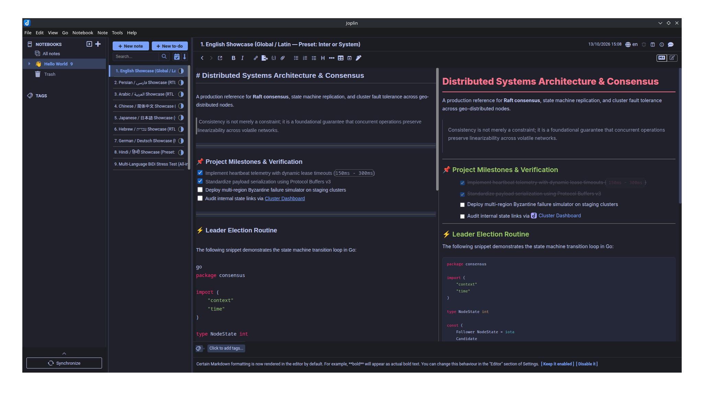
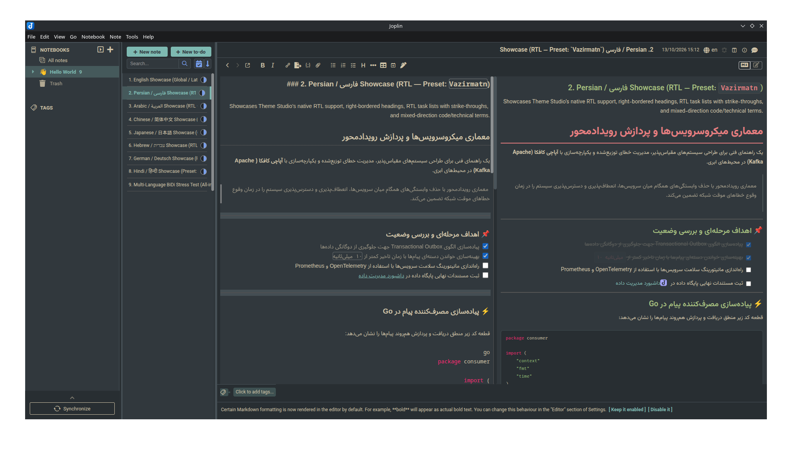
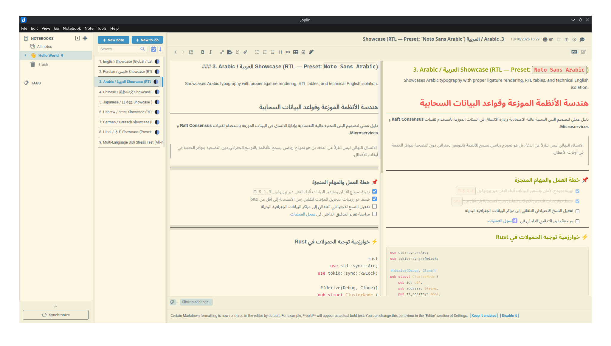

# 🎨 Theme Studio for Joplin

[](https://joplinapp.org/)
[](#-installation)
[](https://opensource.org/licenses/MIT)

Theme Studio is a modular palette and typography engine for Joplin. It applies unified color schemes and typography across the **Markdown Viewer**, the **Markdown Editor** (CodeMirror 6 & 5), the **Rich Text Editor** (TinyMCE), and the **Desktop Application Shell** (Sidebar, Note List, and Toolbars)—eliminating manual edits to `userstyle.css` and `userchrome.css`.

---

## ✨ Features

- **Universal Interface & Editor Theming:** Applies the selected theme across:
  - Note Viewer (`#rendered-md`).
  - CodeMirror Markdown Editor (gutters, syntax highlighting, active line, caret, selection).
  - TinyMCE Rich Text Editor (iframe document and toolbar).
  - Desktop Application Shell (Sidebar, Note List, Header, Search Bar, Splitters, and Sync Panel).
- **12 Integrated Color Schemes:** Switch between dark and light palettes (Tokyo Night, Everforest, Catppuccin, Nord, Dracula, Gruvbox, Atom One) without restarting Joplin.
- **Third-Party Plugin Panel Synchronization:** Propagates theme variables, background colors, and font styles into webview panels created by third-party plugins (such as *Outline* and *Note Tabs*).
- **Configurable Heading Typography Scales:** Choose between balanced, large editorial, compact dense, or custom comma-separated typographic scales for H1 through H6 headings.
- **Smart BiDi Locale Detection:** Queries Joplin's interface language on launch. Automatically defaults to LTR with Inter for global locales, and RTL with Vazirmatn for Persian, Arabic, and Hebrew interfaces.
- **Auto-BiDi Direction Mode:** Includes an `Auto-Detect (Per-Paragraph BiDi)` mode utilizing `unicode-bidi: plaintext` and CSS Logical Properties to align individual paragraphs based on their script direction.
- **Tree Indentation & Toolbar Geometry Preservation:** Maintains Joplin's native nested notebook tree indentation (`padding-left: 16px, 32px, 48px`) while keeping toolbar coordinate layouts intact during RTL mode.
- **International Web Font Engine:** Loads open-source typefaces via CDN on demand (with `display=swap` to eliminate FOIT). Enables custom typography on Joplin Mobile without requiring local OS font installation.
- **Performance Optimized Rendering:** Features an in-memory memoization cache in the Markdown-It parser. Generates compiled CSS once per configuration change, reducing keystroke re-rendering to O(1) memory retrieval.
- **High-Fidelity PDF & Print Export:** Preserves theme backgrounds, syntax colors, and borders using `print-color-adjust: exact`. Tables automatically wrap cells to prevent margin clipping, and code blocks wrap long lines (`pre-wrap`).
- **Responsive Mobile Layout:** Hardened for viewport widths under 768px. Respects configured font sizes, contains Mermaid diagrams within touch-scrollable blocks, and prevents horizontal window sway.
- **Refined Document Elements:**
  - Minimal 1px blockquote borders with transparent backgrounds across RTL, LTR, and print modes.
  - Interactive task lists: Completed items (`- [x]`) dim to 55% opacity with an automatic strikethrough.
  - Image boundaries: Pasted screenshots are centered and bounded (`max-height: 520px`) to prevent oversized image blowouts.
  - Joplin internal links (`:/<id>`) feature a dashed accent underline to distinguish them from external URLs.
  - Formatted styling for native `[[toc]]` and `[^1]` footnotes.

---

## 📸 Screenshots

<p align="center">
  
</p>

### RTL Typography & Auto-BiDi
<p align="center">
  
</p>

### Light Palettes (Everforest Light)
<p align="center">
  
</p>

---

## 🌍 International Font Presets

| Script / Target | Font Preset | Technical Description |
| :--- | :--- | :--- |
| **Global / Latin / Cyrillic** | **Inter** *(Default)* | Variable sans-serif optimized for screens |
| **Clean Modern Sans** | **Roboto** | Standard geometric sans-serif |
| **Persian / Arabic / Urdu** | **Vazirmatn** | Persian and Arabic script typeface |
| **Standard Arabic** | **Noto Sans Arabic** | Modern Noto Arabic typography |
| **Simplified Chinese (CJK)** | **Noto Sans SC** | Comprehensive Simplified Chinese font stack |
| **Japanese (CJK)** | **Noto Sans JP** | Balanced Japanese font stack |
| **Hebrew** | **Heebo** | Clean Hebrew and Latin typography |
| **Devanagari** | **Noto Sans Devanagari** | Complete Hindi and Sanskrit script support |
| **Editorial & Long-form** | **Lora** | Contemporary serif suited for body text |
| **Monospace / Code** | **Fira Code** / **JetBrains Mono** | Developer monospace typefaces with clean punctuation |
| **Operating System Native** | **System Default** | Zero network overhead; uses OS system font stack |

---

## 🎨 Built-In Themes

| Theme | Type | Characteristics |
| :--- | :---: | :--- |
| **Tokyo Night** | Dark | Deep navy background with high-contrast pastel accents |
| **Tokyo Night Storm** | Dark | Medium-contrast slate blue variation |
| **Everforest Dark** | Dark | Nature-inspired warm green background with muted accents |
| **Everforest Light** | Light | Low-contrast paper-toned warm background |
| **Catppuccin Mocha** | Dark | Modern dark palette with soothing pastel accents |
| **Catppuccin Latte** | Light | High-contrast light palette with clean pastel accents |
| **Nord** | Dark | Arctic blue-gray palette with subdued cold tones |
| **Dracula** | Dark | High-contrast dark purple background with vibrant accents |
| **Gruvbox Dark** | Dark | Retro warm brown and amber palette |
| **Gruvbox Light** | Light | Retro parchment light palette with warm accents |
| **Atom One Dark** | Dark | Traditional Atom editor syntax theme |
| **Atom One Light** | Light | High-clarity light theme with crisp editor contrast |
| **Solarized Dark** | Dark | Iconic warm cyan-teal background with earthy accents |
| **Solarized Light** | Light | Warm cream background with the Solarized accent palette |
| **GitHub Dark** | Dark | GitHub's modern dark UI palette with cool grays |
| **GitHub Light** | Light | GitHub's clean light UI palette |
| **Tomorrow Night** | Dark | Classic pastel dark theme with soft syntax colors |
| **Tomorrow** | Light | Classic pastel light theme with soft syntax colors |
| **Ayu Dark** | Dark | Low-saturation dark palette with crisp cyan accents |
| **Ayu Light** | Light | Low-saturation paper palette with cyan accents |
| **Monokai** | Dark | The classic vibrant syntax-highlighting palette |
| **Synthwave '84** | Dark | Retro neon-pink and cyan synthwave aesthetic |

---

## 🚀 Installation

### In-App Plugin Search (Recommended)
1. Open Joplin Desktop.
2. Navigate to **Tools > Options > Plugins** (macOS: **Joplin > Preferences > Plugins**).
3. Search for **`Theme Studio`**.
4. Click **Install** and restart Joplin.

### Manual Installation (`.jpl`)

#### Desktop (Windows, macOS, Linux):
1. Download `org.joplin.plugin.theme-studio.jpl` from the [Releases](https://github.com/xyasharx/joplin-plugin-theme-studio/releases) page.
2. In Joplin, go to **Tools > Options > Plugins**.
3. Click the gear icon (**⚙**) > **Install from file**.
4. Select the downloaded `.jpl` file and restart Joplin.

#### Mobile (Android):
1. Download the `.jpl` file to your mobile device storage.
2. Open Joplin Mobile > Tap **Menu (≡)** > **Configuration** > **Plugins**.
3. Under **Advanced**, tap **Install from file**.
4. Select the `.jpl` file and restart the application.

---

### Whiteboards (desktop)

On Joplin 3.7 and later, the application shell theme also colors the native
whiteboard canvas, controls, and uncolored cards. Disable **Theme Application
Shell** to restore Joplin's whiteboard appearance. Explicit card, group, and
edge colors are kept intact; their shades are chosen by Joplin based on its own
light/dark setting, so choose a matching Joplin appearance for best contrast.
Whiteboard theming depends on Joplin's desktop chrome stylesheet API. It does
not theme third-party drawing plugins or change saved whiteboard data.

## ⚙️ Configuration Reference

Access the settings panel under **Tools > Options > Theme Studio** (on Mobile: **Configuration > Plugins > Theme Studio**). Settings are organized into five groups: **Theme & Appearance**, **Typography**, **Code & Markdown Elements**, **Export**, and **Advanced**.

### Theme & Appearance

| Setting Key | Options / Inputs | Default | Description |
| :--- | :--- | :--- | :--- |
| **Color Theme** | 22 built-in palettes | `Atom One Dark` | Sets document, editor, and UI chrome color tokens |
| **Layout Direction** | `LTR`, `Auto-Detect (BiDi)`, `RTL` | Auto-detected | Primary text direction and border alignment |
| **Apply Theme to Markdown Editor** | `true` / `false` | `true` | Styles CodeMirror 6/5 and TinyMCE editors |
| **Theme Application Shell** | `true` / `false` | `true` | Applies palette to Joplin sidebar, note list, and toolbars (Desktop only) |
| **Color Scheme Mode** | `Use Selected Theme`, `Follow System (Light / Dark)` | `Use Selected Theme` | Follows the OS light/dark preference; themes without a matching counterpart keep their own look |

### Typography

| Setting Key | Options / Inputs | Default | Description |
| :--- | :--- | :--- | :--- |
| **International Font Preset** | 11 font presets | Auto-detected | On-demand web font loaded via CDN |
| **Custom Font Stack** | CSS `font-family` string | System Stack | Active when preset is set to *Custom* |
| **Font Size** | Text string (e.g., `16px`, `18px`) | `16px` | Scales base text size across desktop & mobile |
| **Line Height** | Numeric string (e.g., `1.6`, `1.75`) | `1.75` | Sets body reading line spacing |
| **Heading Sizes Preset** | `Balanced`, `Large`, `Compact`, `Custom` | `Balanced` | Typographic scale applied to H1 through H6 headings |
| **Custom Heading Sizes** | Comma-separated sizes string | `1.75em, 1.42em, ...` | Custom sizes for H1 to H6 (e.g., `28px, 24px, 20px, ...`) |
| **Reading Width (Focus Mode)** | `Full Width`, `Comfortable (920px)`, `Compact (760px)` | `Full Width` | Constrains note container width on wide monitors |

### Code & Markdown Elements

| Setting Key | Options / Inputs | Default | Description |
| :--- | :--- | :--- | :--- |
| **Code Font Preset** | `Fira Code`, `JetBrains Mono`, `System`, `Custom` | `Fira Code` | Monospace font for code blocks and editor |
| **Custom Code Font Stack** | CSS `font-family` string | Cascadia / Consolas | Active when code preset is set to *Custom* |
| **Style Blockquotes** | `true` / `false` | `true` | Apply theme border, background and padding to blockquotes |
| **Style Tables** | `true` / `false` | `true` | Apply theme borders, stripes and cell padding to tables |
| **Style Images** | `true` / `false` | `true` | Apply theme shadow, border-radius and max-height to images |
| **Style Headings** | `true` / `false` | `true` | Apply theme colours and heading accent borders |
| **Style Links** | `true` / `false` | `true` | Apply theme link colour and underline |
| **Style Code Blocks** | `true` / `false` | `true` | Apply theme backgrounds and borders to code blocks and inline code |

### Export

| Setting Key | Options / Inputs | Default | Description |
| :--- | :--- | :--- | :--- |
| **PDF Export Appearance** | `Exact Match`, `Paper Friendly` | `Exact Match` | Controls background retention in exported PDFs |
| **PDF Page Size** | `A4`, `US Letter`, `A5`, `A3`, `US Legal`, `Auto` | `A4` | Standard paper dimensions for PDF export |
| **PDF Page Margins** | `Standard`, `Comfortable`, `Compact`, `None`, `Custom` | `Standard` | Page margin width when exporting to PDF |
| **Custom PDF Page Margins** | CSS margin string | `15mm 18mm` | Active when margins preset is set to *Custom* |

### Advanced

| Setting Key | Options / Inputs | Default | Description |
| :--- | :--- | :--- | :--- |
| **Custom CSS for Notes** | CSS string (single line recommended) | *(empty)* | Extra CSS appended after the theme stylesheet (notes and Rich Text editor) |

---

## 🌗 Automatic Light / Dark Switching

When **Color Scheme Mode** is set to `Follow System (Light / Dark)`, the plugin
emits `@media (prefers-color-scheme: dark)` and `@media (prefers-color-scheme:
light)` blocks that swap in a matched light/dark counterpart palette at runtime,
so the note, editor and application shell follow the OS appearance automatically —
no restart or note re-render needed.

Eight theme families ship as true light/dark pairs and switch seamlessly:
**Atom One**, **Everforest**, **Catppuccin**, **Gruvbox**, **Solarized**,
**GitHub**, **Tomorrow** and **Ayu**. The remaining themes (Tokyo Night,
Tokyo Night Storm, Nord, Dracula, Monokai and Synthwave '84) have no matching
counterpart, so they keep their own look in both schemes rather than silently
changing palette. The native `color-scheme` is set alongside each block so
scrollbars, form controls and other UA chrome follow too.

---

## 👁️ Live Preview Panel

The **Theme Studio: Open live preview** command (Command Palette or Keyboard
Shortcuts) opens a floating panel that renders a sample note using the current
theme, fonts, direction and scheme settings. Edit any setting under **Tools >
Options > Theme Studio** and the preview updates automatically, so you can see
the effect of every change — including per-element style toggles and automatic
light/dark switching — before applying it to your notes.

---

## 💡 Mixed-Language (LTR within RTL) Usage

When **Layout Direction** is set to `RTL`, left-to-right code explanations, English citations, or quotes can be isolated using HTML container syntax:

```html
<div dir="ltr">

### English Subheading
- List markers position on the left margin.
- Hyperlinks and formatting render left-to-right.

> Blockquotes format with a left accent border.

</div>
```

*Tip: Selecting `Auto-Detect (Per-Paragraph BiDi)` handles mixed-language paragraphs automatically without requiring manual `div` tags.*

---

## 🛠️ Development & Build Pipeline

### Prerequisites
- Node.js >= 20.9.0
- npm >= 9.0.0

### Build Instructions
```bash
# 1. Clone the repository
git clone https://github.com/xyasharx/joplin-plugin-theme-studio.git
cd joplin-plugin-theme-studio

# 2. Install locked dependencies
npm ci

# 3. Type-check, build, and run regression tests
npm test

# 4. Build the .jpl bundle
npm run dist
```

The build uses TypeScript 7 for type checking and esbuild-loader for transpilation.
Both `npm run build` and `npm run dist` run the type check; the loader does
not type-check by itself.

### Publishing safely

Before running the **Build & Release** workflow, update the version in
`package.json`, `package-lock.json` (including its root package), and
`src/manifest.json`. The workflow refuses existing release tags, versions not
newer than the latest published release, mismatched version files, and tags
that do not match the checked-out commit. A failed GitHub API check also stops
publishing. Local `npm run build` and `npm run dist` do not publish releases.

The check runs in the workflow version at the selected ref: do not manually
run an older tag whose workflow predates this safeguard. Release workflows are
serialized, but changes made independently through GitHub's UI or API cannot
be locked by this workflow.

The compiled archive and hash metadata will be generated in the `publish/` directory:
- `publish/org.joplin.plugin.theme-studio.jpl`
- `publish/org.joplin.plugin.theme-studio.json`

---

## 📄 License

This project is licensed under the [MIT License](LICENSE).
